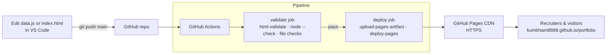
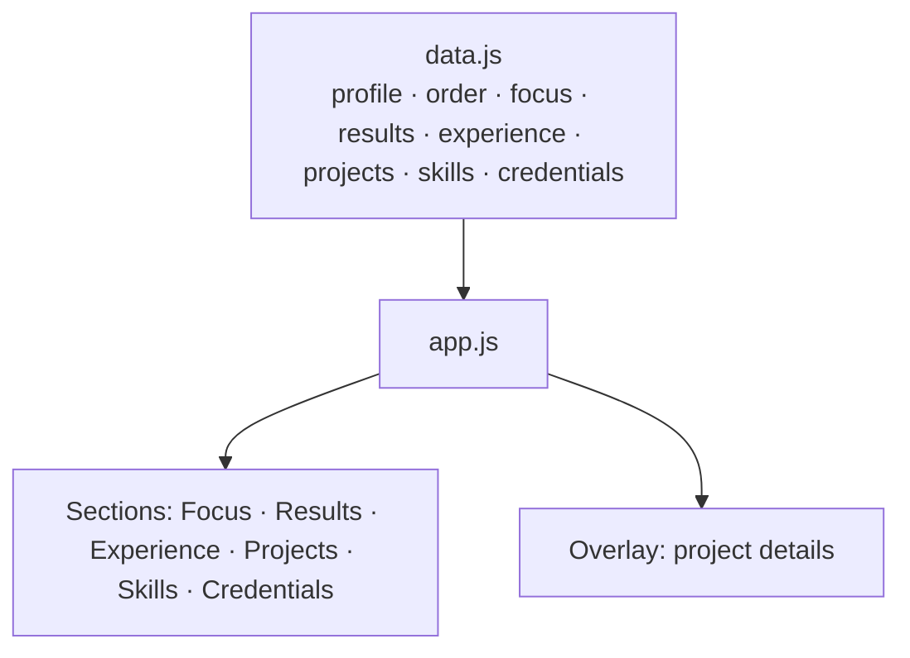

# Sai Teja K · Portfolio (Cinematic Edition)

**DevOps Engineer · Platform Engineer · SRE · AIOps**

🔗 **Live site:** https://kumbham8888.github.io/portfolio

[](https://github.com/KUMBHAM8888/portfolio/actions/workflows/deploy.yml)

My portfolio, with a cinematic red-on-black interface. (My original portfolio is still live at https://kumbham8888.github.io.) It opens straight to the main page: name, summary and resume first, then results, experience, projects and skills. Every push to `main` is validated and deployed by a GitHub Actions pipeline, the same way I ship production services.

---

## Contents

- [What's on the site](#whats-on-the-site)
- [Interactive highlights](#interactive-highlights)
- [Tech stack](#tech-stack)
- [Architecture](#architecture)
- [How I built it](#how-i-built-it)
- [CI/CD pipeline](#cicd-pipeline)
- [Project structure](#project-structure)
- [Updating the content](#updating-the-content)
- [Run it locally](#run-it-locally)
- [Roadmap](#roadmap)
- [Contact](#contact)

---

## What's on the site

| Section | What it shows |
|---|---|
| **Banner** | My name, summary, roles, and **Resume** and **Contact** buttons over a cinematic portrait |
| **About** | Who I am in four short paragraphs, an "At a glance" fact card (role, experience, industries, cloud, compliance, certification, education, location) and core skills |
| **Current Focus** | Current role and work in progress |
| **Key Results** | Measured outcomes: 60% less provisioning, 40% fewer failed deployments, release windows from 4h to under 1h, and more |
| **Experience** | Every role on one LinkedIn-style timeline, newest first: NextEra Energy, JPMorgan Chase, Verizon. Each shows role, dates with calculated duration, location, project, a short write-up in plain paragraphs, and tools |
| **Projects** | Project cards with generated cover art. Select one for the details, features, tech stack and architecture flow |
| **Skills** | CI/CD, containers, IaC, cloud, DevSecOps, observability, scripting and AI |
| **Certifications & Education** | AWS Certified Developer – Associate and MS in Computer Science |
| **Get in touch** | Email (with copy button), LinkedIn, GitHub and the resume PDF |


---

## Interactive highlights

Small, purposeful motion that guides the eye without getting in the way. All of it is vanilla CSS and JavaScript, with no libraries.

| Effect | Where | What it does |
|---|---|---|
| **Role spotlight** | Banner | All four roles stay visible; every 1.8s one turns white with a red underline, so recruiters see every role at a glance |
| **Section spotlight** | Every section, including About | One item at a time gets a red bar and a section-specific highlight: red play button (Focus), full-red number (Results), red company name (Experience), lifted poster (Projects), red title (Skills) |
| **Glass hover** | Every card | A frosted sheen follows the cursor, with a soft edge and a bright top rim, like light catching glass |

**How it's built to behave**

- **Only what you can see.** The spotlight cycles through items currently on screen, and each section runs only while it's in view (`IntersectionObserver`).
- **Hover wins.** Pointing at an item highlights it and pauses that section's cycle. Hover is read live with `:hover`, so it never gets stuck.
- **Mouse only for glass.** The glass effect is limited to `(hover: hover) and (pointer: fine)`, so phones don't get a stuck glow after a tap.
- **Accessible.** With `prefers-reduced-motion`, both spotlights switch off and the page shows the original static layout. Text and contrast are never reduced, so every number stays readable.
- **One shared function.** A single `spotlight(container, itemSelector)` in `app.js` powers every section, so adding it to a new section is one line.

---

## Tech stack

| Layer | Tool |
|---|---|
| Markup | HTML5 with `<dialog>` for overlays |
| Styling | Hand-written CSS with custom properties (no framework) |
| Behavior | Vanilla JavaScript, no dependencies, no build step |
| Content | One data file: `assets/js/data.js` |
| Fonts | Google Fonts: Big Shoulders Display, Instrument Sans, JetBrains Mono |
| CI | GitHub Actions: `html-validate`, `node --check`, required-file checks |
| CD / Hosting | GitHub Pages via `actions/deploy-pages`, HTTPS by default |

---

## Architecture



If any check fails, the deploy job never runs, so a broken page can't go live. The previous version stays up.



---

## How I built it

1. **Content first.** Every fact comes from my resume, organized into the sections recruiters scan for.
2. **One source of truth.** All content lives in `assets/js/data.js`. `app.js` renders every row from it, so updating the site means editing one file.
3. **Straight to the point.** No intro screens: visitors land on my name, summary and the Resume button, then results first.
4. **Generated cover art.** Project covers are SVG drawn in code from a two-color palette and a motif (rings, pulse, stack), so there are no image files to manage.
5. **Design tokens.** Colors, fonts and spacing are CSS custom properties in `:root`.
6. **Mobile-first rows.** Rows scroll sideways with snap points on touch devices, and arrow buttons appear only on devices with a mouse.
7. **Accessibility.** Native `<dialog>` overlays (Esc closes, focus is managed), semantic `<article>` entries for each role in Experience, visible focus states, and `prefers-reduced-motion` turns off all animation.
8. **Privacy.** The public resume PDF leaves out my phone number.
9. **Link previews.** Open Graph tags so the URL shows my photo and title on LinkedIn.
10. **Shipped through CI/CD.** GitHub Actions validates and deploys every push to `main`.
11. **Readable by search engines and resume parsers.** The About section is plain HTML in `index.html`, not rendered by JavaScript, so tools that don't run scripts can still read it. A schema.org `Person` block in `<head>` gives search engines my title, skills, certification and profiles.

---

## CI/CD pipeline

Workflow file: [`.github/workflows/deploy.yml`](.github/workflows/deploy.yml)

| Step | What happens |
|---|---|
| **Trigger** | `push` to `main`, or a manual run (`workflow_dispatch`) |
| **validate** | `html-validate` on `index.html` (rules in `.htmlvalidate.json`), `node --check` on both JavaScript files, and a check that every required file exists |
| **deploy** | Runs only if validate passes: configure Pages, upload the site as an artifact, publish with `actions/deploy-pages` |
| **Permissions** | Least privilege: `contents: read`, `pages: write`, `id-token: write` (OIDC for Pages) |
| **Concurrency** | One deployment at a time; a newer push cancels an older in-progress run |

---

## Project structure

```
.
├── index.html                    # Page shell: nav, banner, About, contact section, dialog, schema.org data
├── assets/
│   ├── css/style.css             # All styles and design tokens
│   ├── js/data.js                # ALL content (edit this to update the site)
│   ├── js/app.js                 # Renders rows, project overlays, spotlight and glass effects
│   ├── photo.jpg                 # Portrait (banner and link previews)
│   └── Sai_Teja_K_Resume.pdf     # Public resume (phone number removed)
├── .github/workflows/deploy.yml  # CI/CD: validate, then deploy to GitHub Pages
├── .htmlvalidate.json            # HTML lint rules used in CI
└── README.md
```

---

## Updating the content

Edit **`assets/js/data.js`**, commit and push. The pipeline does the rest.

| To change | Edit in `data.js` |
|---|---|
| Email, links, resume, photo | `profile` |
| Order of the sections | `order` |
| Current Focus cards | `focus` |
| Headline numbers | `results` |
| Jobs and their write-ups | `experience` (each role's `description` is a list of paragraphs) |
| Projects (cards and detail view) | `projects` (add an object and it appears automatically) |
| Skills | `skills` |
| Certifications and education | `certifications`, `education` |

The banner text and the **About** section are in `index.html`, kept as plain HTML on purpose (see How I built it, step 11). To change the photo or resume, replace the files in `assets/` and keep the same names.

**After changing CSS or JavaScript**, bump the `?v=` number on the three `<link>`/`<script>` tags in `index.html` (for example `?v=20261010` to today's date). Browsers cache these files, and a new version number makes every visitor download the fresh copy instead of mixing a new page with old styles.

---

## Run it locally

```bash
git clone git@github.com:KUMBHAM8888/portfolio.git
cd portfolio
python -m http.server 8000        # then open http://localhost:8000

# The same checks CI runs
npx html-validate index.html
node --check assets/js/data.js
node --check assets/js/app.js
```

---

## Roadmap

**Next: AWS with Infrastructure as Code**

- [ ] Terraform: S3 + CloudFront + ACM + Route 53 for a custom domain
- [ ] GitHub Actions deploy to S3 with OIDC (no long-lived AWS keys)
- [ ] Visitor counter with API Gateway + Lambda + DynamoDB
- [ ] Uptime check and an AWS billing alert

---

## Contact

- **Email:** saitejagoudk01@gmail.com
- **LinkedIn:** [in/saitejagoudk](https://www.linkedin.com/in/saitejagoudk/)
- **GitHub:** [KUMBHAM8888](https://github.com/KUMBHAM8888)

Open to DevOps, Platform Engineering and SRE roles, remote or with relocation.
